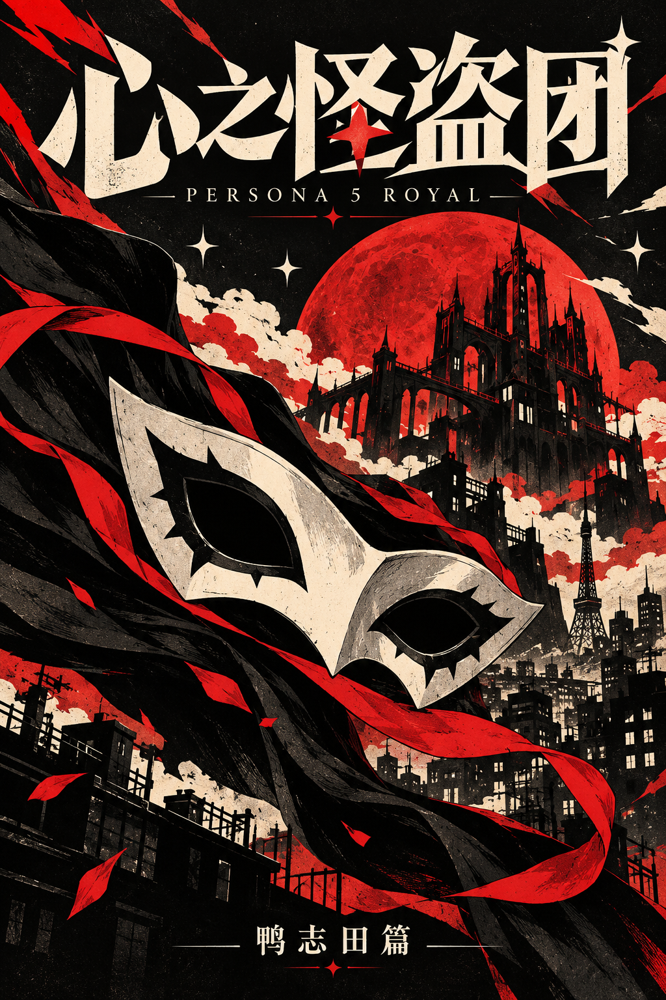

# 心之怪盗团

《女神异闻录5 皇家版》同人角色卡（SillyTavern）的发布仓库。这里只放构建好的游戏程序、图片和角色卡文件，卡里的入口脚本会通过 jsDelivr 按版本号从这里加载。

## 下载与使用

1. 下载 [PNG角色卡原文件](https://raw.githubusercontent.com/cy4268/p5r-phantom-thieves-release/main/cards/%E5%BF%83%E4%B9%8B%E6%80%AA%E7%9B%97%E5%9B%A2-0.3.3.png)，在 SillyTavern 里导入；也保留[同内容JSON](cards/心之怪盗团-0.3.3.card.json)。请保存原文件，截图或平台压缩后的图片可能丢失卡片数据。
2. 导入时选择导入内嵌世界书，并启用卡内脚本（需要酒馆助手扩展）。
3. 点击输入框上方的「进入怪盗团」开始游戏。

预设兼容、游玩方式等说明，见角色卡的"创作者备注"。

## 版本

- `0.3.3`：加入四人普通枪械、购枪换装、逐发选目标与弹药显示，修正结束射击的键盘操作；更新队友战斗站姿及枪击世界书说明。程序地址：`https://cdn.jsdelivr.net/gh/cy4268/p5r-phantom-thieves-release@0.3.3/p5r.js`
- `0.3.2`：接入8首场景BGM及原作循环点，手机内可跟随场景／手动选曲／暂停；保留现有FLAC音质。程序地址：`https://cdn.jsdelivr.net/gh/cy4268/p5r-phantom-thieves-release@0.3.2/p5r.js`
- `0.3.1`：删除战斗中的像素人物兜底画法，开战预加载动作立绘；动作图未到时用站姿。玩法、存档格式和世界书内容沿用0.3.0。程序地址：`https://cdn.jsdelivr.net/gh/cy4268/p5r-phantom-thieves-release@0.3.1/p5r.js`
- `0.3.0`：本地进度保护、东京总览与宫殿分层、商店与邀约、面具和战斗技能菜单、战斗结算及世界书更新。程序地址：`https://cdn.jsdelivr.net/gh/cy4268/p5r-phantom-thieves-release@0.3.0/p5r.js`
- `0.2.2`：世界书里主角统一用玩家自己的名字称呼（怪盗代号仍是 Joker）。程序地址：`https://cdn.jsdelivr.net/gh/cy4268/p5r-phantom-thieves-release@0.2.2/p5r.js`
- `0.2.1`：开始新游戏面板改成新玩家看得懂的说法。程序地址：`https://cdn.jsdelivr.net/gh/cy4268/p5r-phantom-thieves-release@0.2.1/p5r.js`
- `0.2.0`：鸭志田篇测试版，4 月 9 日到 5 月 2 日鸭志田公开认罪。程序地址：`https://cdn.jsdelivr.net/gh/cy4268/p5r-phantom-thieves-release@0.2.0/p5r.js`
- `0.1.0`：首版，序章到鸭志田城堡第一场战斗。程序地址：`https://cdn.jsdelivr.net/gh/cy4268/p5r-phantom-thieves-release@0.1.0/p5r.js`

每个程序版本都有对应的 git 标签，已发布的标签内容不会再改动。本版同时提供PNG和JSON，内嵌数据相同。[0.3.0的PNG补档](https://raw.githubusercontent.com/cy4268/p5r-phantom-thieves-release/7e26c97e45bf73d8987b54305bc1e74b9c7abf7c/cards/%E5%BF%83%E4%B9%8B%E6%80%AA%E7%9B%97%E5%9B%A2-0.3.0.png)仍可下载。

## 升级与音乐

从公开版0.2.2或更早版本升级到0.3.3，请导入新卡和内嵌世界书后新建聊天。旧聊天继续使用[0.2.2角色卡](https://github.com/cy4268/p5r-phantom-thieves-release/blob/0.2.2/cards/心之怪盗团-0.2.2.card.json)及原版本程序，不要直接覆盖旧聊天进度。更新已有卡之前，请先备份卡片和聊天。

0.3.0至0.3.2已有存档不会补发初始枪：可在军品店购买并从队伍页装备，下一场战斗生效。新开局按剧情发放初始枪。射击采用本卡简化：四人逐发单目标，可以换目标或结束射击；新击倒接1 MORE，每场战斗补满弹药。

**已装旧版世界书的注意事项：** 酒馆可能直接把新卡关联到同名旧书，且不弹出导入提示。请先备份并保留旧书，将新版102条内嵌世界书另存为独立的新书、绑定到新卡；不要直接覆盖旧书，否则旧版聊天也会受影响。全新安装不受此同名问题影响。PNG与JSON数据相同，此问题不会因改成图片格式而消失。

手机内的音乐页支持按场景选曲、手选、暂停与音量控制。8首FLAC保留现有音频样本和原作循环点，作为[独立音乐附件](https://github.com/cy4268/p5r-phantom-thieves-release/releases/tag/bgm-1.0.0)按需读取当前一首；无需手动下载整包。首次播放取决于到GitHub的网络，浏览器限制自动播放时请点击游戏或音乐页“播放”。

## 声明

游戏角色与世界观属于 ATLUS / SEGA。本作是非商业同人作品，与官方无关。画面中的人物和背景是 AI 生成的同人图，没有使用从游戏中提取的素材。
背景音乐使用本机游戏音源的FLAC封装，音频版权属于原权利人；它保留解码样本，不代表发行OST的无损母带。
